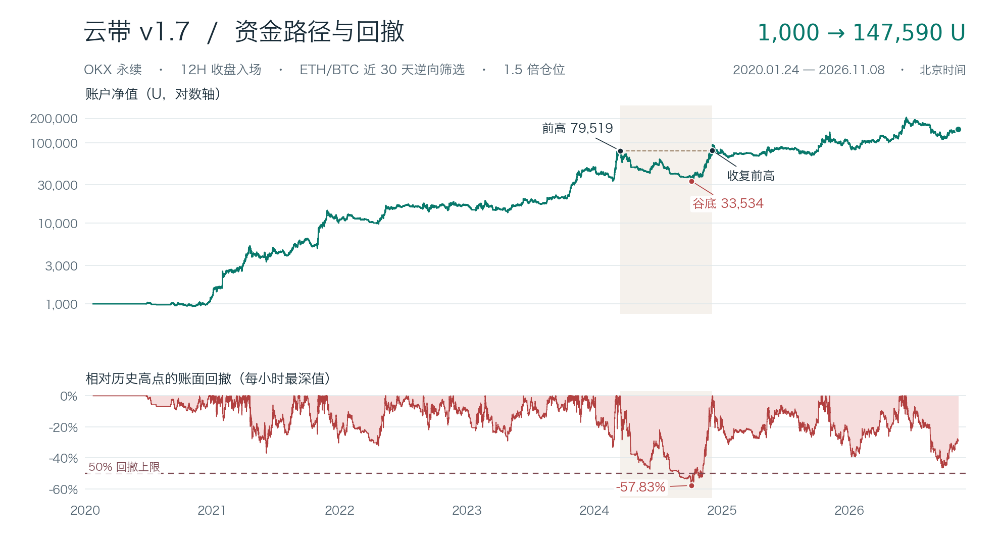

# 云带 v1.7 · 12H 逆向策略小册

OKX 的 USDT 永续合约 · 12 小时收盘确认 · 9 个仓位 · 单仓 1.5 倍名义敞口

## 概览

这套策略做的是趋势中的一次反向插针。做多时，个币的快均线在慢均线上方，价格一度跌出纽约周一下方的延伸区，但在 12 小时收盘前收了回来。此时还要看到 ETH 相对 BTC 在过去 30 天走弱。做空的三个方向全部反过来。名称里的“逆向”指 ETH/BTC 过滤方向，个币本身仍沿云带趋势开仓。

历史从 1,000U 起步，终值 147,590.50U，共 1,252 笔，涉及 247 个实际开仓币种。263 笔盈利，989 笔亏损。胜率 21.01%，单笔平均盈利 1,873.47U，平均亏损 349.98U，金额盈亏比 5.35。所有盈利单的盈利总额除以所有亏损单的亏损总额为 1.42。仓位随净值变化，因此单笔金额之比与单笔收益率之比（8.18）不同。

原来的目标是资金超过 1,000 倍、胜率至少 20%、最大回撤不超过 50%。原方案全期达到 147.59 倍，账面最大回撤 57.83%，小时高低价估计上界 58.54%。它达到胜率门槛，收益与回撤两项均未达标。独立模拟账户从启用时以 1,000U 记账。

## 交易规则

### 先画周一的上下轨

以纽约当地时间划周，取周一零时至周二零时完整的高点 H 与低点 L，区间宽度 W = H − L。下轨 = L − 0.618 × W，上轨 = H + 0.618 × W。区间完成后才生效，到下个纽约周一零时到期，夏令时按当地日历调整。用于判定的整根 12H K 线必须位于这段有效期内。

### 等一根已经收盘的 12H 信号

K 线按 UTC 对齐，北京时间每天 08:00、20:00 收盘。EMA20 和 EMA50 都使用截至信号收盘的价格，连续预热至少 50 根，遇缺口重新预热。每币每个纽约周，多空合计只取第一根符合下列形态的 K 线。后续即使相对强弱不合、满仓或同币已有仓位，本周也不会用第二根补上。

| 检查 | 做多 | 做空 |
| --- | --- | --- |
| 个币趋势 | EMA20 > EMA50 | EMA20 < EMA50 |
| 影线 | 最低价 < 下轨 | 最高价 > 上轨 |
| 收盘 | 下轨 < 收盘价 < 上轨 | 下轨 < 收盘价 < 上轨 |
| ETH/BTC 近 30 天 | 下降 | 上升 |

ETH/BTC 用同一交易所 ETH、BTC 两份 USDT 合约的已收盘价格相除，在信号收盘时和 60 根 12H 之前比较。比值不变、参考数据不全时跳过。个币在信号 K 开始前还要有 181 个连续的 12H 收盘观测，覆盖此前 90 天，同一时刻至少 10 个合约满足历史覆盖。这个门槛检查的是数据长度，并不要求个币排进涨幅榜。

### 几个币同时发信号，先开哪个

先处理较早的入场时钟。同一时钟内，按信号 K 前一根已收盘的 Wilder ATR14 除以该根收盘价排序，数值低者优先。相同时按币种代码 CRC32 排序。9 个资金槽共享现金，同币只容纳一笔。已占用的槽位在原回测的同小时开仓阶段仍算占用。

单笔保证金预算取两者较小值：账户净值 ÷ 9，或可用现金 ÷ 剩余空槽数。根据 1.5 倍名义敞口预留入场费。初始 1,000U、9 槽全空时，首笔名义成交额约 166.54U。后续金额随账户净值和已有仓位变化。

### 开仓后如何分批退出

1. **定风险。** 按实际入场价与固定止损价的距离定义 1R。BTC 与 ETH 的止损距触及侧轨道向外 1.5%，其他币为 3%。例如山寨多单的止损 = 下轨 × 0.97，空单 = 上轨 × 1.03。止损是相对轨道定价，和距开仓价 3% 有区别。
2. **前 12 小时。** 以初始仓位的 2/3 挂 2R 止盈，剩余 1/3 跟随趋势。限价仅在入场后的第一个 12H 窗内有效，窗口到期仍未触发的份额继续按保护规则持有。
3. **多单翻倍。** 价格首次达到入场价的两倍，按原分仓结构兑现当时余仓的一半。初始四份配置分别为 1/3（2R 或翻倍）、1/3（2R）、1/6（翻倍）、1/6（跟随）。已平份额不能再平一次。空单没有翻倍兑现条件。
4. **每小时控制集中度。** 以前一小时收盘价和账户净值检查，单币名义敞口超过净值 20% 时，在下一小时开盘处理开盘退出后，按剩余子仓等比例卖出或买回超额部分。趋势走得越远，可能发生的减仓次数越多。
5. **保护余仓。** 根据最近一根已收盘 12H 的两条 EMA 反推出下一根会令两线相等的价格。持仓期间按 1H 价格检查，严格穿过对持仓不利的一侧即触发云带反转退出。固定止损触价即生效。若开盘已跳过保护位，按可观察开盘价处理。同一小时同时碰到不利保护位和有利止盈、却无更细顺序时，历史按保护优先；若两条不利保护线都能触及，取较近者。

历史以确认时钟对应的真实 1H 开盘价建仓。前向账户只对启用后收到的信号记账。收盘确认、收到信号、取得可用报价是三个时刻，复盘时要检查它们之间的延迟。

### 本地模拟怎样记成交

前向使用 OKX 公开行情。每次收盘给全市场扫描最多 15 分钟收齐同一批次，按原优先级处理。买入取实际观察到的卖一，卖出取买一，报价最多允许滞后 15 秒。数据迟到、缺报价、同币占用或满仓都会留下入场判定。交易所的撮合队列和盘口冲击未在本地模拟中重建。

若在小时中途开仓，入场后的第一个完整分钟起用 1 分钟 K 线检查保护，再切回完整小时。入场报价到下一分钟开始之间可能有未观察到的波动。后续依据收盘的分钟或小时线记模拟退出，页面可区分行情所属时钟与确认时间，盘中触价只能定位到相应时间区间。

前向账户使用最近可得的公开行情估值。遇到持仓合约停牌或退市且缺少可确认的退出价，保留持仓和最后估值，等行情恢复或核对官方交割，页面标出数据异常并暂停新入场。历史退市交割中的假设价格不会自动写入前向账户。

## 三笔交易怎样读

**CFX 空单，2024-06-07。** 入场 0.23050，固定止损 0.23893013，1R = 0.00843013。向下 2R 是 0.21363974，早期止盈份额成交；跟随份额之后在 0.17380 按开盘云带反转退出。整笔扣费后 +864.55U。只看最后退出价会高估先落袋部分的收益。

**TRX 多单，2022-06-12。** 入场 0.07622，固定止损 0.07279128，四份均以止损结束，整笔 −123.02U。开仓时它也通过了云带、周一影线、ETH/BTC 三道检查。单笔图左侧展示开仓时的信息，右侧展示后来的价格路径。

**BEAT 多单，2026-05-10。** 入场 0.5434，翻倍价 1.0868，跟随份额最后在约 1.73172 退出。其间发生多次 20% 敞口减仓，整笔净赚 55,392.05U，约占全期净利润的 37.8%。完整子仓流水可以核对翻倍止盈和每次减仓。

[CFX 空单图](../cloud-v17-history/charts/cloud-v17-000643.svg) · [TRX 止损图](../cloud-v17-history/charts/cloud-v17-000251.svg) · [BEAT 多单图](../cloud-v17-history/charts/cloud-v17-001082.svg)

## 风险与成本

最深的一轮回撤发生在 2024 年。3 月 14 日前高约 79,519U，10 月 4 日谷底约 33,534U，12 月 3 日收复前高，前高到收复接近 264 天。历史净值曲线按小时盯市，含持仓浮盈亏。账面 57.83% 来自小时内可重建的估值阶段；58.54% 用小时高、低估值组合计算，受一小时持仓缺报价及 OHLC 分辨率影响。

全期做多 618 笔，合计 +122,906U；做空 634 笔，合计 +23,684U。最大的十笔盈利合计为全期净利润的 120.15%，其余交易合计亏损。2025 年账户净值增长 23.17%，2026 年至 11 月 8 日增长 51.11%。这两段历史在研究时已经看过，独立前向记录从账户启用日开始。

基准按每边市价 0.05%、挂单止盈 0.02% 扣费。另在每次市价成交增加 0.05% 不利滑点，历史终值降至 123,004U，回撤上界 59.55%。原回测未计永续资金费或历史盘口深度。对退市退出使用已核对的结算资料，部分未公布交割费的标的按零交割费情景处理。首尾截断、缺 K 及数据性退出应结合每笔图的覆盖说明阅读。

## 账本与图谱

历史覆盖 2020-01-24 至 2026-11-08 12:00 UTC。图谱以实际占用资金的一笔母交易为一张，可按币种、多空、日期和盈亏筛选。每笔的净盈亏包含各子仓成交、手续费、减仓；图上标示的末次退出价只代表相应退出。小时内的触发只能定位到该小时，图中延伸到退出后的 K 线用于复盘。

[在线策略小册](https://spikeok.com/static/strategy-booklet/cloud-v17/index.html) · [全部历史开仓图](https://spikeok.com/static/strategy-booklet/cloud-v17/index.html#history) · [资金单 CSV](https://spikeok.com/static/strategy-booklet/cloud-v17/funded.csv)

原始实验编号为 exp-cloud-close-alt-season-delivery-20261109-v1，方向分支 opposite，仓位 1.5x，成本情景 fee-only。
